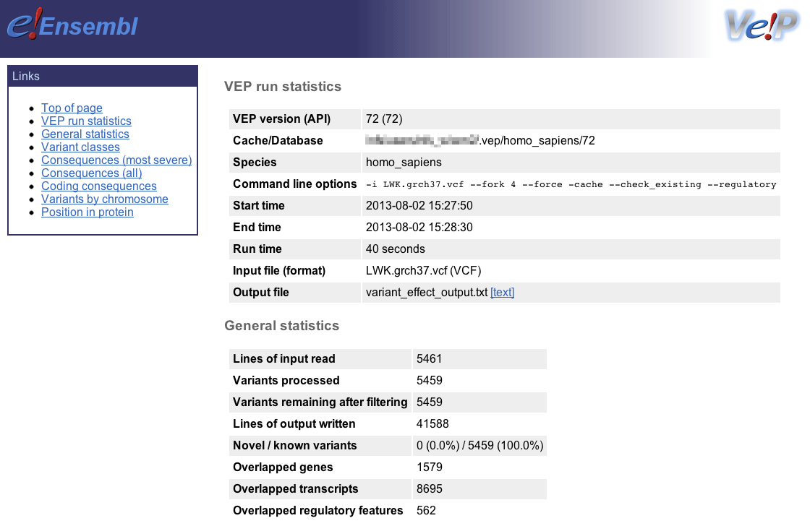
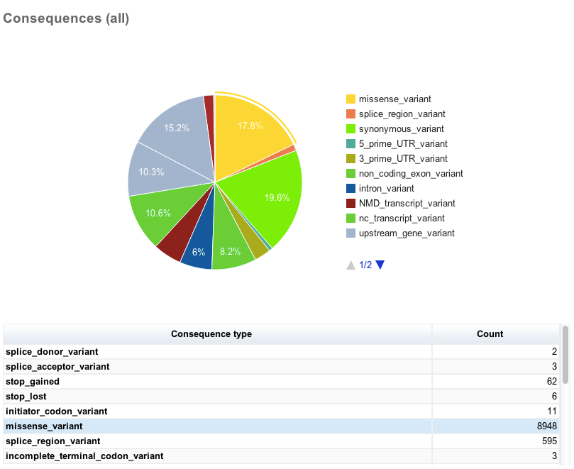
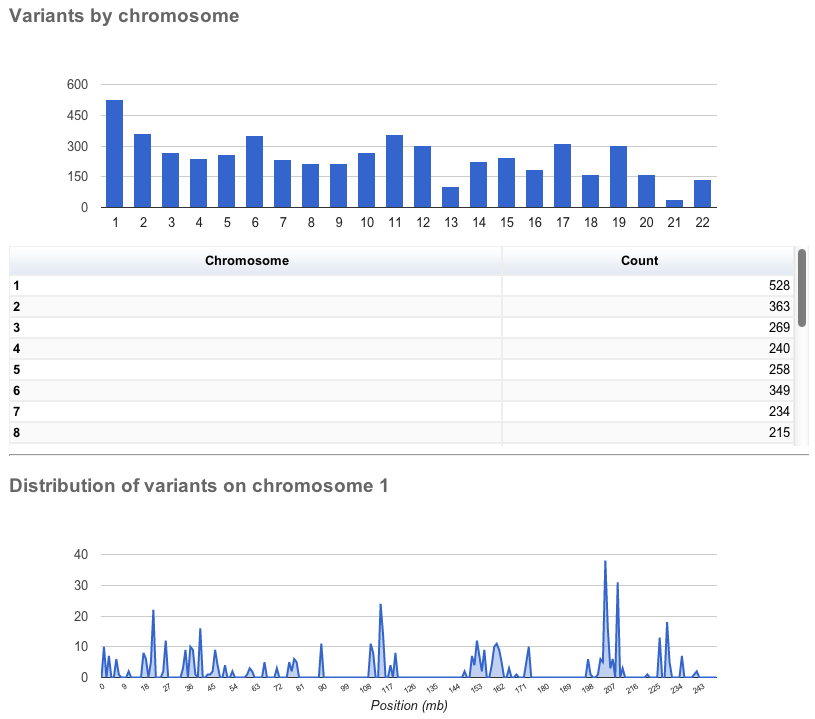

# VEP data formats

**On this page**

- [Input](/help/articles/vep-data-formats#input)
- [Default Ensembl VEP input](/help/articles/vep-data-formats#default)
- [VCF](/help/articles/vep-data-formats#vcf)
- [HGVS identifiers](/help/articles/vep-data-formats#hgvs)
- [Variant identifiers](/help/articles/vep-data-formats#id)
- [Genomic SPDI notation](/help/articles/vep-data-formats#spdi)
- [REST-style regions](/help/articles/vep-data-formats#region)
- [Structural variant types](/help/articles/vep-data-formats#sv)
- [Output](/help/articles/vep-data-formats#output)
- [Default Ensembl VEP output](/help/articles/vep-data-formats#defaultout)
- [Tab-delimited output](/help/articles/vep-data-formats#tab)
- [VCF output](/help/articles/vep-data-formats#vcfout)
- [JSON output](/help/articles/vep-data-formats#json)
- [Statistics](/help/articles/vep-data-formats#stats)

## Input

Both the web and command line interfaces to Ensembl VEP can use the same input formats.

Supported input formats:

### `Default Ensembl VEP input`

**Variant example:** `1 881907 881906 -/C +`

**Structural variant example:** `1 160283 471362 DUP +`

### `VCF`

**Variant example:** `1 65568 . A C . . .`

**Structural variant example:** `1 7936271 . N N[12:58877476[ . . SVTYPE=BND`

### `HGVS identifiers`

**Variant example:** `ENST00000618231.3:c.9G>C`

**Structural variant example:** ✗ Not supported

### `Variant identifiers`

**Variant example:** `rs699`

**Structural variant example:** `nsv1000164`

### `Genomic SPDI notation`

**Variant example:** `NC_000016.10:68684738:G:A`

**Structural variant example:** ✗ Not supported

### `REST-style regions`

**Variant example:** `14:19584687-19584687:-1/T`

**Structural variant example:** `21:25587759-25587769/DEL`

### Note

Ensembl VEP can read compressed (gzipped) input file of any format listed above, e.g.:

<pre style="width: var(--text-column-width, 450px); max-width: 100%; box-sizing: border-box; white-space: pre-wrap; overflow-wrap: anywhere;"><code class="language-text">./vep -i input.vcf.gz -o output.txt
</code></pre>

## Default Ensembl VEP input

The default format is a simple **whitespace-separated** format (columns may be separated by space or tab characters), containing five required columns plus an optional identifier column:

1.  **chromosome** - just the name or number, with no 'chr' prefix
2.  **start**
3.  **end**
4.  **allele** - pair of alleles separated by a '/', with the reference allele first (or [structural variant type)](/help/articles/vep-data-formats#sv)
5.  **strand** - defined as + (forward) or - (reverse). The alleles will be reverse complemented for mapping to the genome if the minus strand is provided.
6.  **identifier** - this identifier will be used the output. If not provided, Ensembl VEP will construct an identifier from the given coordinates and alleles.

<pre style="width: var(--text-column-width, 450px); max-width: 100%; box-sizing: border-box; white-space: pre-wrap; overflow-wrap: anywhere;"><code class="language-text">1   881907    881906    -/C   +
2   946507    946507    G/C   +
5   140532    140532    T/C   +
8   150029    150029    A/T   +    var2
12  1017956   1017956   T/A   +
14  19584687  19584687  C/T   -
19  66520     66520     G/A   +    var1
</code></pre>

An insertion (of any size) is indicated by start coordinate = end coordinate + 1. For example, an insertion of 'C' between nucleotides 12600 and 12601 on the forward strand of chromosome 8 is indicated as follows:

<pre style="width: var(--text-column-width, 450px); max-width: 100%; box-sizing: border-box; white-space: pre-wrap; overflow-wrap: anywhere;"><code class="language-text">8   12601     12600     -/C   +
</code></pre>

A deletion is indicated by the exact nucleotide coordinates. For example, a three base pair deletion of nucleotides 12600, 12601, and 12602 of the reverse strand of chromosome 8 will be:

<pre style="width: var(--text-column-width, 450px); max-width: 100%; box-sizing: border-box; white-space: pre-wrap; overflow-wrap: anywhere;"><code class="language-text">8   12600     12602     CGT/- -
</code></pre>

Structural variants are also supported by indicating a [structural variant type](/help/articles/vep-data-formats#sv) instead of the allele:

<pre style="width: var(--text-column-width, 450px); max-width: 100%; box-sizing: border-box; white-space: pre-wrap; overflow-wrap: anywhere;"><code class="language-text">1    20000     30000     CN4  +  cnv4
1    160283    471362    DUP  +  dup
1    1385015   1387562   DEL  +  del1
12   1017956   1017956   INV  +  inv
21   25587759  25587769  CN0  +  del2
</code></pre>

## VCF

[VCF (Variant Call Format) version 4.0](http://www.1000genomes.org/wiki/Analysis/vcf4.0) is supported. This is a common format produced by many variant calling tools and is the recommended format for use with Ensembl VEP:

<pre style="width: var(--text-column-width, 450px); max-width: 100%; box-sizing: border-box; white-space: pre-wrap; overflow-wrap: anywhere;"><code class="language-text">#CHROM  POS        ID      REF  ALT            QUAL  FILTER  INFO  FORMAT
1       65568      .       A    C              .     .       .     .
1       230710048  rs699   A    G              .     .       .     .
2       265023     .       C    T              .     .       .     .
3       319780     .       GA   G              .     .       .     .
20      3          .       C    CAAG,CAAGAAG   .     PASS    .     .
21      43762120   rs1300  T    A,C,G          .     .       .     .
</code></pre>

Structural variants are also supported depending on [structural variant type.](/help/articles/vep-data-formats#sv)

Users using VCF should note a peculiarity in the difference between how Ensembl and VCF describe unbalanced variants. For any unbalanced variant (i.e. insertion, deletion or unbalanced substitution), the VCF specification requires that the base immediately before the variant should be included in both the reference and variant alleles. This also affects the reported position i.e. the reported position will be one base before the actual site of the variant.

In order to parse this correctly, Ensembl VEP needs to convert such variants into Ensembl-type coordinates, and it does this by removing the additional base and adjusting the coordinates accordingly. This means that if an identifier is not supplied for a variant (in the 3rd column of the VCF), then the identifier constructed and the position reported in Ensembl VEP output file will differ from the input.

This problem can be overcome with the following:

1.  ensuring each variant has a unique identifier specified in the 3rd column of the VCF
2.  using VCF format as output ([--vcf](/help/articles/vep-options-output-format#opt_vcf)) - this preserves the formatting of your input coordinates and alleles
3.  using [--minimal](/help/articles/vep-options-output-format#opt_minimal) and [--allele_number](/help/articles/vep-options-output#opt_allele_number) (see [Complex VCF entries](/help/articles/vep-data-formats#complex_vcf)).

The following examples illustrate how VCF describes a variant and how it is handled internally by Ensembl VEP. Consider the following aligned sequences (for the purposes of discussion on chromosome 20):

<pre style="width: var(--text-column-width, 450px); max-width: 100%; box-sizing: border-box; white-space: pre-wrap; overflow-wrap: anywhere;"><code class="language-text">Ref: a t C g a // C is the reference base
1 : a t G g a // C base is a G in individual 1
2 : a t - g a // C base is deleted w.r.t. the reference in individual 2
3 : a t CAg a // A base is inserted w.r.t. the reference sequence in individual 3
</code></pre>

### Individual 1

The first individual shows a simple balanced substitution of G for C at base 3. This is described in a compatible manner in VCF and Ensembl styles. Firstly, in VCF:

<pre style="width: var(--text-column-width, 450px); max-width: 100%; box-sizing: border-box; white-space: pre-wrap; overflow-wrap: anywhere;"><code class="language-text">20   3   .   C   G   .   PASS   .
</code></pre>

And in Ensembl format:

<pre style="width: var(--text-column-width, 450px); max-width: 100%; box-sizing: border-box; white-space: pre-wrap; overflow-wrap: anywhere;"><code class="language-text">20   3   3   C/G   +
</code></pre>

### Individual 2

The second individual has the 3rd base deleted relative to the reference. In VCF, both the reference and variant allele columns must include the preceding base (T) and the reported position is that of the preceding base:

<pre style="width: var(--text-column-width, 450px); max-width: 100%; box-sizing: border-box; white-space: pre-wrap; overflow-wrap: anywhere;"><code class="language-text">20   2   .   TC   T   .   PASS   .
</code></pre>

In Ensembl format, the preceding base is not included, and the start/end coordinates represent the region of the sequence deleted. A "-" character is used to indicate that the base is deleted in the variant sequence:

<pre style="width: var(--text-column-width, 450px); max-width: 100%; box-sizing: border-box; white-space: pre-wrap; overflow-wrap: anywhere;"><code class="language-text">20   3   3   C/-   +
</code></pre>

The upshot of this is that while in the VCF input file the position of the variant is reported as 2, in the output file in Ensembl VEP default format the position will be reported as 3. If no identifier is provided in the third column of the VCF, then the constructed identifier will be:

<pre style="width: var(--text-column-width, 450px); max-width: 100%; box-sizing: border-box; white-space: pre-wrap; overflow-wrap: anywhere;"><code class="language-text">20_3_C/-
</code></pre>

### Individual 3

The third individual has an "A" inserted between the 3rd and 4th bases of the sequence relative to the reference. In VCF, as for the deletion, the base before the insertion is included in both the reference and variant allele columns, and the reported position is that of the preceding base:

<pre style="width: var(--text-column-width, 450px); max-width: 100%; box-sizing: border-box; white-space: pre-wrap; overflow-wrap: anywhere;"><code class="language-text">20   3   .   C   CA   .   PASS   .
</code></pre>

In Ensembl format, again the preceding base is not included, and the start/end positions are "swapped" to indicate that this is an insertion. Similarly to a deletion, a "-" is used to indicate no sequence in the reference:

<pre style="width: var(--text-column-width, 450px); max-width: 100%; box-sizing: border-box; white-space: pre-wrap; overflow-wrap: anywhere;"><code class="language-text">20   4   3   -/A   +
</code></pre>

Again, the output will appear different, and the constructed identifier may not be what is expected:

<pre style="width: var(--text-column-width, 450px); max-width: 100%; box-sizing: border-box; white-space: pre-wrap; overflow-wrap: anywhere;"><code class="language-text">20_3_-/A
</code></pre>

Using VCF format output, or adding unique identifiers to the input (in the third VCF column), can mitigate this issue.

### Complex VCF entries

For VCF entries with multiple alternate alleles, Ensembl VEP will only trim the leading base from alleles if **all** REF and ALT alleles start with the same base:

<pre style="width: var(--text-column-width, 450px); max-width: 100%; box-sizing: border-box; white-space: pre-wrap; overflow-wrap: anywhere;"><code class="language-text">20   3   .   C   CAAG,CAAGAAG   .   PASS   .
</code></pre>

This will be considered internally by Ensembl VEP as equivalent to:

<pre style="width: var(--text-column-width, 450px); max-width: 100%; box-sizing: border-box; white-space: pre-wrap; overflow-wrap: anywhere;"><code class="language-text">20   4   3   -/AAG/AAGAAG   +
</code></pre>

Now consider the case where a single VCF line contains a representation of both a SNV and an insertion:

<pre style="width: var(--text-column-width, 450px); max-width: 100%; box-sizing: border-box; white-space: pre-wrap; overflow-wrap: anywhere;"><code class="language-text">20   3   .   C   CAAAG,G   .   PASS   .
</code></pre>

Here the input alleles will remain unchanged, and Ensembl VEP will consider the first REF/ALT pair as a substitution of C for CAAG, and the second as a C/G SNV:

<pre style="width: var(--text-column-width, 450px); max-width: 100%; box-sizing: border-box; white-space: pre-wrap; overflow-wrap: anywhere;"><code class="language-text">20   3   3   C/CAAG/G   +
</code></pre>

To modify this behaviour, with the commandline tool you can use [--minimal](/help/articles/vep-options-output-format#opt_minimal). This flag forces Ensembl VEP to consider each REF/ALT pair independently, trimming identical leading and trailing bases from each as appropriate. Since this can lead to confusing output regarding coordinates etc, it is not the default behaviour. It is recommended to use the [--allele_number](/help/articles/vep-options-output#opt_allele_number) flag to track the correspondence between alleles as input and how they appear in the output.

## HGVS identifiers

See <https://varnomen.hgvs.org> for details. These must be relative to genomic or Ensembl transcript coordinates.

It also is possible to use RefSeq transcripts, if they match the reference genome See [HGVS documentation](/help/articles/vep-other-information#hgvs)

Examples:

<pre style="width: var(--text-column-width, 450px); max-width: 100%; box-sizing: border-box; white-space: pre-wrap; overflow-wrap: anywhere;"><code class="language-text">ENST00000618231.3:c.9G&gt;C
ENST00000471631.1:c.28_33delTCGCGG
ENST00000285667.3:c.1047_1048insC
5:g.140532G&gt;C
</code></pre>

Examples using RefSeq identifiers (using [--refseq](/help/articles/vep-options-cache#opt_refseq) in the command line or select the 'RefSeq transcripts' on the web interface:

<pre style="width: var(--text-column-width, 450px); max-width: 100%; box-sizing: border-box; white-space: pre-wrap; overflow-wrap: anywhere;"><code class="language-text">NM_153681.2:c.7C&gt;T
NM_005239.6:c.190G&gt;A
NM_001025204.2:c.336G&gt;A
</code></pre>

HGVS protein notations may also be used, provided that they unambiguously map to a single genomic change. Due to redundancy in the amino acid code, it is not always possible to work out the corresponding genomic sequence change for a given protein sequence change. The following example is for a permissable protein notation in dog *(Canis familiaris)*:

<pre style="width: var(--text-column-width, 450px); max-width: 100%; box-sizing: border-box; white-space: pre-wrap; overflow-wrap: anywhere;"><code class="language-text">ENSCAFP00000040171.1:p.Thr92Asn
</code></pre>

### Ambiguous gene-based descriptions

It is possible to use ambiguous descriptions listing only gene symbol or UniProt accession and protein change (e.g. PHF21B:p.Tyr124Cys, P01019:p.Ala268Val), as seen in the literature, though this is not recommended as it can produce multiple different variants at genomic level. The transcripts for a gene are considered in the following order:

1.  [MANE Select transcript status](https://jun2026.archive.ensembl.org/info/genome/genebuild/mane.html)
2.  [MANE Plus Clinical transcript status](https://jun2026.archive.ensembl.org/info/genome/genebuild/mane.html)
3.  canonical status of transcript
4.  [APPRIS isoform annotation](https://jun2026.archive.ensembl.org/glossary/ENSGLOSSARY_0000012)
5.  [transcript support level](https://jun2026.archive.ensembl.org/glossary/ENSGLOSSARY_0000005)
6.  biotype of transcript ("protein_coding" preferred)
7.  CCDS status of transcript
8.  consequence rank according to [this table](https://jun2026.archive.ensembl.org/info/genome/variation/prediction/predicted_data.html#consequences)
9.  translated, transcript or feature length (longer preferred)

and the first compatible transcript is used to map variants to the genome for annotation. 

## Variant identifiers

These should be dbSNP rsIDs (such as `rs699`), or any synonym for a variant present in the Ensembl Variation database. Structural variant identifiers (like `nsv1000164` and `esv1850194`) are also supported.

See [here](https://jun2026.archive.ensembl.org/info/genome/variation/species/sources_documentation.html) for a list of identifier sources in Ensembl.

Examples:

<pre style="width: var(--text-column-width, 450px); max-width: 100%; box-sizing: border-box; white-space: pre-wrap; overflow-wrap: anywhere;"><code class="language-text">rs1156485833
rs1258750482
rs867704559
esv1815690
nsv1000164
</code></pre>

### Note

Ensembl VEP is optimised for the analysis of variants in VCF files (sorted by location) or other position-based formats. Using variant identifiers can take 2-5 times longer as a database lookup to find the variant location is required.

## Genomic SPDI notation

Genomic SPDI notation which uses four fields delimited by colons S:P:D:I (Sequence:Position:Deletion:Insertion) is also supported. In SPDI notation, the position refers to the base before the variant, not the base of the variant itsef.

See [here](https://www.ncbi.nlm.nih.gov/variation/notation/) for details.

Examples:

<pre style="width: var(--text-column-width, 450px); max-width: 100%; box-sizing: border-box; white-space: pre-wrap; overflow-wrap: anywhere;"><code class="language-text">NC_000016.10:68684738:G:A
NC_000017.11:43092199:GCTTTT:
NC_000013.11:32315789::C
NC_000016.10:68644746:AA:GTA
16:68684738:2:AC
</code></pre>

## REST-style regions

The Ensembl VEP region REST endoint requires variants are described as `[chr]:[start]-[end]:[strand]/[allele]`.

This follows the same conventions as the [default input format](/help/articles/vep-data-formats#default), with the key difference being that this format does not require the reference (REF) allele to be included; this will be looked up using either a provided FASTA file (preferred) or Ensembl core database. Strand is optional and defaults to 1 (forward strand).

<pre style="width: var(--text-column-width, 450px); max-width: 100%; box-sizing: border-box; white-space: pre-wrap; overflow-wrap: anywhere;"><code class="language-text"># SNP
5:140532-140532:1/C

# SNP (reverse strand)
14:19584687-19584687:-1/T

# insertion
1:881907-881906:1/C

# 5bp deletion
2:946507-946511:1/-
</code></pre>

Structural variants are also supported by indicating a [structural variant type](/help/articles/vep-data-formats#sv) in the place of the `[allele]`:

<pre style="width: var(--text-column-width, 450px); max-width: 100%; box-sizing: border-box; white-space: pre-wrap; overflow-wrap: anywhere;"><code class="language-text"># structural variant: deletion
21:25587759-25587769/DEL
    
# structural variant: inversion
21:25587759-25587769/INV
</code></pre>

## Structural variant types

Ensembl VEP also predicts molecular consequences for structural variants using the following input formats:

- [Default Ensembl VEP input](/help/articles/vep-data-formats#default)
- [REST-style regions](/help/articles/vep-data-formats#region)
- [Variant identifiers](/help/articles/vep-data-formats#id)
- [VCF](/help/articles/vep-data-formats#vcf)

To recognise a variant as a structural variant, the allele string (or `SVTYPE` in the INFO column of the VCF format) must be set to one of the currently supported values:

- **INS** - insertion
  - **INS:ME** - insertion of mobile element
  - **INS:ME:ALU** - insertion of ALU element
  - **INS:ME:HERV** - insertion of HERV element
  - **INS:ME:LINE1** - insertion of LINE1 element
  - **INS:ME:SVA** - insertion of SVA element
- **DEL** - deletion
  - **DEL:ME** - deletion of mobile element
  - **DEL:ME:ALU** - deletion of ALU element
  - **DEL:ME:HERV** - deletion of HERV element
  - **DEL:ME:LINE1** - deletion of LINE1 element
  - **DEL:ME:SVA** - deletion of SVA element
- **DUP** - duplication
  - **DUP:TANDEM** - tandem duplication
  - **TDUP** - tandem duplication
- **INV** - inversion
- **CNV** - copy number variation
  - The copy number value can be specified like so:
    - `CN0`
    - `CN=4`
    - `CN3,CN4,CN6`
    - `CN=0,CN=2,CN=4`
  - **CNV:TR** - tandem repeats
    - Requires `INFO` fields describing the tandem repeat, such as `RUS` and `RN` – check [VCF 4.4 specification, section 5.7](https://samtools.github.io/hts-specs/VCFv4.4.pdf)
    - Currently, the `CIRUC` and `CIRB` `INFO` fields are ignored when calculating alternative alleles in tandem repeats
- **BND** - chromosome breakpoints
  - Breakpoint variants are composed by one or more breakends
  - In VCF, breakend replacements are inserted into the `ALT` column and need to meet the [HTS specifications](http://samtools.github.io/hts-specs/), such as `TG[12:58877476[`
  - Single breakends can be specified in `ALT`, such as `T.` and `.G`
  - Multiple, comma-separated alternative breakends can be specified in `ALT`, such as `A[22:22893780[,A[X:10932343[`
  - Breakends are only supported for VCF input format

More information on how Ensembl VEP processes structural variants can be found [here](/help/articles/vep-examples-and-use-cases#StructVar).

### Examples of structural variants encoded in VCF format

<pre style="width: var(--text-column-width, 450px); max-width: 100%; box-sizing: border-box; white-space: pre-wrap; overflow-wrap: anywhere;"><code class="language-text">#CHROM  POS        ID   REF  ALT             QUAL  FILTER  INFO
1       160283     dup  .    &lt;DUP&gt;           .     .       SVTYPE=DUP;END=471362
1       1385015    del  .    &lt;DEL&gt;           .     .       SVTYPE=DEL;END=1387562
1       7936271    bnd  N    N[12:58877476[  .     .       SVTYPE=BND
</code></pre>

See the [VCF definition document](http://www.1000genomes.org/wiki/Analysis/Variant%20Call%20Format/VCF%20%28Variant%20Call%20Format%29%20version%204.0/encoding-structural-variants) for more detail on how to describe structural variants in VCF format.

## Output

Ensembl VEP can return the results in different formats:

- [Default Ensembl VEP output](/help/articles/vep-data-formats#defaultout)
- [Tab-delimited output](/help/articles/vep-data-formats#tab)
- [VCF](/help/articles/vep-data-formats#vcfout)
- [JSON output](/help/articles/vep-data-formats#json)

Along with the results Ensembl VEP computes and returns some [statistics](/help/articles/vep-data-formats#stats).

## Default Ensembl VEP output

The default output format ("VEP" format when downloading from the web interface) is a 14 column tab-delimited file. Empty values are denoted by '-'. The output columns are:

1.  **Uploaded variation** - as chromosome_start_alleles
2.  **Location** - in standard coordinate format (chr:start or chr:start-end)
3.  **Allele** - the variant allele used to calculate the consequence
4.  **Gene** - Ensembl stable ID of affected gene
5.  **Feature** - Ensembl stable ID of feature
6.  **Feature type** - type of feature. Currently one of Transcript, RegulatoryFeature, MotifFeature.
7.  **Consequence** - [consequence type](https://jun2026.archive.ensembl.org/info/genome/variation/prediction/predicted_data.html#consequences) of this variant
8.  **Position in cDNA** - relative position of base pair in cDNA sequence
9.  **Position in CDS** - relative position of base pair in coding sequence
10. **Position in protein** - relative position of amino acid in protein
11. **Amino acid change** - only given if the variant affects the protein-coding sequence
12. **Codon change** - the alternative codons with the variant base in upper case
13. **Co-located variation** - identifier of any [existing variants](/help/articles/vep-other-information#colocated). Switch on with [--check_existing](/help/articles/vep-options-existing-variants#opt_check_existing)
14. **Extra** - this column contains extra information as key=value pairs separated by ";", see below.

### Other output fields:

- **REF_ALLELE** - the reference allele (after minimisation)
- **UPLOADED_ALLELE** - the uploaded allele string (before minimisation)
- **IMPACT** - the impact modifier for the consequence type
- **VARIANT_CLASS** - Sequence Ontology [variant class](https://jun2026.archive.ensembl.org/info/genome/variation/prediction/classification.html#classes)
- **SYMBOL** - the gene symbol
- **SYMBOL_SOURCE** - the source of the gene symbol
- **STRAND** - the DNA strand (1 or -1) on which the transcript/feature lies
- **ENSP** - the Ensembl protein identifier of the affected transcript
- **FLAGS** - transcript quality flags:
  - *cds_start_NF:* CDS 5' incomplete
  - *cds_end_NF:* CDS 3' incomplete
- **SWISSPROT** - Best match UniProtKB/Swiss-Prot accession of protein product
- **TREMBL** - Best match UniProtKB/TrEMBL accession of protein product
- **UNIPARC** - Best match UniParc accession of protein product
- **HGVSc** - the HGVS coding sequence name
- **HGVSp** - the HGVS protein sequence name
- **HGVSg** - the HGVS genomic sequence name
- **HGVS_OFFSET** - Indicates by how many bases the HGVS notations for this variant have been [shifted](/help/articles/vep-options-identifiers#opt_shift_hgvs). Value must be greater than 0.
- **NEAREST** - Identifier(s) of nearest transcription start site
- **SIFT** - the SIFT prediction and/or score, with both given as prediction(score)
- **PolyPhen** - the PolyPhen prediction and/or score
- **MOTIF_NAME** - the source and identifier of a transcription factor binding profile aligned at this position
- **MOTIF_POS** - The relative position of the variation in the aligned TFBP
- **HIGH_INF_POS** - a flag indicating if the variant falls in a high information position of a transcription factor binding profile (TFBP)
- **MOTIF_SCORE_CHANGE** - The difference in motif score of the reference and variant sequences for the TFBP
- **CELL_TYPE** - List of cell types and classifications for regulatory feature
- **CANONICAL** - a flag indicating if the transcript is denoted as the canonical transcript for this gene
- **CCDS** - the CCDS identifer for this transcript, where applicable
- **INTRON** - the intron number (out of total number)
- **EXON** - the exon number (out of total number)
- **DOMAINS** - the source and identifer of any overlapping protein domains
- **DISTANCE** - Shortest distance from variant to transcript. *Note: DISTANCE of 0 is possible for insertions happening just before or after a transcript because variant coordinates are considered to be the flanking bases where insertion happens.*
- **IND** - individual name
- **ZYG** - zygosity of individual genotype at this locus
- **SV** - IDs of overlapping structural variants
- **FREQS** - Frequencies of overlapping variants used in filtering
- **AF** - Frequency of existing variant in 1000 Genomes
- **AFR_AF** - Frequency of existing variant in 1000 Genomes combined African population
- **AMR_AF** - Frequency of existing variant in 1000 Genomes combined American population
- **ASN_AF** - Frequency of existing variant in 1000 Genomes combined Asian population
- **EUR_AF** - Frequency of existing variant in 1000 Genomes combined European population
- **EAS_AF** - Frequency of existing variant in 1000 Genomes combined East Asian population
- **SAS_AF** - Frequency of existing variant in 1000 Genomes combined South Asian population
- **gnomADe_AF** - Frequency of existing variant in gnomAD exomes combined population
- **gnomADe_AFR_AF** - Frequency of existing variant in gnomAD exomes African/American population
- **gnomADe_AMR_AF** - Frequency of existing variant in gnomAD exomes American population
- **gnomADe_ASJ_AF** - Frequency of existing variant in gnomAD exomes Ashkenazi Jewish population
- **gnomADe_EAS_AF** - Frequency of existing variant in gnomAD exomes East Asian population
- **gnomADe_FIN_AF** - Frequency of existing variant in gnomAD exomes Finnish population
- **gnomADg_MID_AF** - Frequency of existing variant in gnomAD exomes Mid-eastern population
- **gnomADe_NFE_AF** - Frequency of existing variant in gnomAD exomes Non-Finnish European population
- **gnomADe_REMAINING_AF** - Frequency of existing variant in gnomAD exomes combined remaining combined populations
- **gnomADe_SAS_AF** - Frequency of existing variant in gnomAD exomes South Asian population
- **gnomADg_AF** - Frequency of existing variant in gnomAD genomes combined population
- **gnomADg_AFR_AF** - Frequency of existing variant in gnomAD genomes African/American population
- **gnomADg_AMI_AF** - Frequency of existing variant in gnomAD genomes Amish population
- **gnomADg_AMR_AF** - Frequency of existing variant in gnomAD genomes American population
- **gnomADg_ASJ_AF** - Frequency of existing variant in gnomAD genomes Ashkenazi Jewish population
- **gnomADg_EAS_AF** - Frequency of existing variant in gnomAD genomes East Asian population
- **gnomADg_FIN_AF** - Frequency of existing variant in gnomAD genomes Finnish population
- **gnomADg_MID_AF** - Frequency of existing variant in gnomAD genomes Mid-eastern population
- **gnomADg_NFE_AF** - Frequency of existing variant in gnomAD genomes Non-Finnish European population
- **gnomADg_REMAINING_AF** - Frequency of existing variant in gnomAD genomes combined remaining combined populations
- **gnomADg_SAS_AF** - Frequency of existing variant in gnomAD genomes South Asian population
- **MAX_AF** - Maximum observed allele frequency in 1000 Genomes, ESP and gnomAD
- **MAX_AF_POPS** - Populations in which maximum allele frequency was observed
- **CLIN_SIG** - ClinVar clinical significance of the dbSNP variant
- **BIOTYPE** - Biotype of transcript or regulatory feature
- **APPRIS** - Annotates alternatively spliced transcripts as primary or alternate based on a range of computational methods. NB: not available for GRCh37
- **TSL** - Transcript support level. NB: not available for GRCh37
- **GENCODE_PRIMARY** - Reports if transcript belongs to GENCODE primary subset
- **PUBMED** - Pubmed ID(s) of publications that cite existing variant
- **SOMATIC** - Somatic status of existing variant(s); multiple values correspond to multiple values in the Existing_variation field
- **PHENO** - Indicates if existing variant is associated with a phenotype, disease or trait; multiple values correspond to multiple values in the Existing_variation field
- **GENE_PHENO** - Indicates if overlapped gene is associated with a phenotype, disease or trait
- **ALLELE_NUM** - Allele number from input; 0 is reference, 1 is first alternate etc
- **MINIMISED** - Alleles in this variant have been converted to minimal representation before consequence calculation
- **PICK** - indicates if this block of consequence data was picked by [--flag_pick](/help/articles/vep-options-filtering#opt_flag_pick) or [--flag_pick_allele](/help/articles/vep-options-filtering#opt_flag_pick_allele)
- **BAM_EDIT** - Indicates success or failure of edit using BAM file
- **GIVEN_REF** - Reference allele from input
- **USED_REF** - Reference allele as used to get consequences
  

- **REFSEQ_MATCH** - the RefSeq transcript match status; contains a number of flags indicating whether this RefSeq transcript matches the underlying reference sequence and/or an Ensembl transcript ([more information](/help/articles/vep-other-information#refseq)).
  - *rseq_3p_mismatch:* signifies a mismatch between the RefSeq transcript and the underlying primary genome assembly sequence. Specifically, there is a mismatch in the 3' UTR of the RefSeq model with respect to the primary genome assembly (e.g. GRCh37/GRCh38).
  - *rseq_5p_mismatch:* signifies a mismatch between the RefSeq transcript and the underlying primary genome assembly sequence. Specifically, there is a mismatch in the 5' UTR of the RefSeq model with respect to the primary genome assembly.
  - *rseq_cds_mismatch:* signifies a mismatch between the RefSeq transcript and the underlying primary genome assembly sequence. Specifically, there is a mismatch in the CDS of the RefSeq model with respect to the primary genome assembly.
  - *rseq_ens_match_cds:* signifies that for the RefSeq transcript there is an overlapping Ensembl model that is identical across the CDS region only. A CDS match is defined as follows: the CDS and peptide sequences are identical and the genomic coordinates of every translatable exon match. Useful related attributes are: rseq_ens_match_wt and rseq_ens_no_match.
  - *rseq_ens_match_wt:* signifies that for the RefSeq transcript there is an overlapping Ensembl model that is identical across the whole transcript. A whole transcript match is defined as follows: 1) In the case that both models are coding, the transcript, CDS and peptide sequences are all identical and the genomic coordinates of every exon match. 2) In the case that both transcripts are non-coding the transcript sequences and the genomic coordinates of every exon are identical. No comparison is made between a coding and a non-coding transcript. Useful related attributes are: rseq_ens_match_cds and rseq_ens_no_match.
  - *rseq_ens_no_match:* signifies that for the RefSeq transcript there is no overlapping Ensembl model that is identical across either the whole transcript or the CDS. This is caused by differences between the transcript, CDS or peptide sequences or between the exon genomic coordinates. Useful related attributes are: rseq_ens_match_wt and rseq_ens_match_cds.
  - *rseq_mrna_match:* signifies an exact match between the RefSeq transcript and the underlying primary genome assembly sequence (based on a match between the transcript stable id and an accession in the RefSeq mRNA file). An exact match occurs when the underlying genomic sequence of the model can be perfectly aligned to the mRNA sequence post polyA clipping.
  - *rseq_mrna_nonmatch:* signifies a non-match between the RefSeq transcript and the underlying primary genome assembly sequence. A non-match is deemed to have occurred if the underlying genomic sequence does not have a perfect alignment to the mRNA sequence post polyA clipping. It can also signify that no comparison was possible as the model stable id may not have had a corresponding entry in the RefSeq mRNA file (sometimes happens when accessions are retired or changed). When a non-match occurs one or several of the following transcript attributes will also be present to provide more detail on the nature of the non-match: rseq_5p_mismatch, rseq_cds_mismatch, rseq_3p_mismatch, rseq_nctran_mismatch, rseq_no_comparison
  - *rseq_nctran_mismatch:* signifies a mismatch between the RefSeq transcript and the underlying primary genome assembly sequence. This is a comparison between the entire underlying genomic sequence of the RefSeq model to the mRNA in the case of RefSeq models that are non-coding.
  - *rseq_no_comparison:* signifies that no alignment was carried out between the underlying primary genome assembly sequence and a corresponding RefSeq mRNA. The reason for this is generally that no corresponding, unversioned accession was found in the RefSeq mRNA file for the transcript stable id. This sometimes happens when accessions are retired or replaced. A second possibility is that the sequences were too long and problematic to align (though this is rare).
- **OverlapBP** - Number of base pairs overlapping with the corresponding structural variation feature
- **OverlapPC** - Percentage of corresponding structural variation feature overlapped by the given input
- **CHECK_REF** - Reports variants where the input reference does not match the expected reference
- **AMBIGUITY** - IUPAC allele ambiguity code

Example of Ensembl VEP default output format:

<pre style="width: var(--text-column-width, 450px); max-width: 100%; box-sizing: border-box; white-space: pre-wrap; overflow-wrap: anywhere;"><code class="language-text">11_224088_C/A    11:224088   A  ENSG00000142082  ENST00000525319  Transcript         missense_variant           742  716  239  T/N  aCc/aAc  -  SIFT=deleterious(0);PolyPhen=unknown(0)
11_224088_C/A    11:224088   A  ENSG00000142082  ENST00000534381  Transcript         5_prime_UTR_variant        -    -    -    -    -        -  -
11_224088_C/A    11:224088   A  ENSG00000142082  ENST00000529055  Transcript         downstream_variant         -    -    -    -    -        -  -
11_224585_G/A    11:224585   A  ENSG00000142082  ENST00000529937  Transcript         intron_variant             -    -    -    -    -        -  HGVSc=ENST00000529937.1:c.136-346G&gt;A
22_16084370_G/A  22:16084370 A  -                ENSR00000615113  RegulatoryFeature  regulatory_region_variant  -    -    -    -    -        -  -
</code></pre>

The Ensembl VEP command line tool will also add a header to the output file. This contains information about the databases connected to, and also a key describing the key/value pairs used in the extra column.

<pre style="width: var(--text-column-width, 450px); max-width: 100%; box-sizing: border-box; white-space: pre-wrap; overflow-wrap: anywhere;"><code class="language-text">## ENSEMBL VARIANT EFFECT PREDICTOR v116.0
## Output produced at 2017-03-21 14:51:27
## Connected to homo_sapiens_core_116_38 on ensembldb.ensembl.org
## Using cache in /homes/user/.vep/homo_sapiens/116_GRCh38
## Using API version 116, DB version 116
## polyphen version 2.2.2
## sift version sift5.2.2
## COSMIC version 78
## ESP version 20141103
## gencode version GENCODE 25
## genebuild version 2014-07
## HGMD-PUBLIC version 20162
## regbuild version 16
## assembly version GRCh38.p7
## ClinVar version 201610
## dbSNP version 147
## Column descriptions:
## Uploaded_variation : Identifier of uploaded variant
## Location : Location of variant in standard coordinate format (chr:start or chr:start-end)
## Allele : The variant allele used to calculate the consequence
## Gene : Stable ID of affected gene
## Feature : Stable ID of feature
## Feature_type : Type of feature - Transcript, RegulatoryFeature or MotifFeature
## Consequence : Consequence type
## cDNA_position : Relative position of base pair in cDNA sequence
## CDS_position : Relative position of base pair in coding sequence
## Protein_position : Relative position of amino acid in protein
## Amino_acids : Reference and variant amino acids
## Codons : Reference and variant codon sequence
## Existing_variation : Identifier(s) of co-located known variants
## Extra column keys:
## IMPACT : Subjective impact classification of consequence type
## DISTANCE : Shortest distance from variant to transcript
## STRAND : Strand of the feature (1/-1)
## FLAGS : Transcript quality flags
</code></pre>

## Tab-delimited output

The [--tab](/help/articles/vep-options-output-format#opt_tab) specifies a tab-delimited output file. **This differs from the default output format in that each individual field from the "Extra" field is written to a separate tab-delimited column**. This makes the output more suitable for import into spreadsheet programs such as Excel. Furthermore the header is the same as the one for the Ensembl VEP default output format and this is also the format used when selecting the "TXT" option on the Ensembl VEP web interface.

Example of tab-delimited output format:

<pre style="width: var(--text-column-width, 450px); max-width: 100%; box-sizing: border-box; white-space: pre-wrap; overflow-wrap: anywhere;"><code class="language-text">#Uploaded_variation  Location   Allele  Gene             Feature          Feature_type  Consequence                            cDNA_position  CDS_position  Protein_position  Amino_acids  Codons   Existing_variation  IMPACT    DISTANCE  STRAND  FLAGS 
11_224088_C/A        11:224088  A       ENSG00000142082  ENST00000525319  Transcript    missense_variant                       742            716           239               S/I          aGc/aTc  -                   MODERATE  -         -1      - 
11_224088_C/A        11:224088  A       ENSG00000142082  ENST00000534381  Transcript    downstream_gene_variant                -              -             -                 -            -        -                   MODIFIER  1674      -1      -
11_224088_C/A        11:224088  A       ENSG00000142082  ENST00000529055  Transcript    downstream_gene_variant                -              -             -                 -            -        -                   MODIFIER  134       -1      -
11_224585_G/A        11:224585  A       ENSG00000142082  ENST00000529937  Transcript    intron_variant,NMD_transcript_variant  -              -             -                 -            -        -                   MODIFIER  -         -1      -
</code></pre>

### Note

The Existing_variation column is only populated if we use option [--check_existing](/help/articles/vep-options-existing-variants#opt_check_existing) or any other option that switches it on (--af_1kg silently switches on --check_existing).

The choice and order of columns in the output may be configured using [--fields](/help/articles/vep-options-output-format#opt_fields). For instance:

<pre style="width: var(--text-column-width, 450px); max-width: 100%; box-sizing: border-box; white-space: pre-wrap; overflow-wrap: anywhere;"><code class="language-text">./vep -i examples/homo_sapiens_GRCh38.vcf --cache --force_overwrite --tab --fields &quot;Uploaded variation,Location,Allele,Gene&quot;
</code></pre>

## VCF output

The Ensembl VEP commandline tool can also generate VCF output using the [--vcf](/help/articles/vep-options-output-format#opt_vcf) flag.

Main information about the VCF output format:

- Consequences are added in the INFO field of the VCF file, using the key "**CSQ**" (you can change it using [--vcf_info_field](/help/articles/vep-options-output#opt_vcf_info_field)).
- Data fields are encoded separated by the character "**|**" (pipe). The order of fields is written in the VCF header. Unpopulated fields are represented by an empty string.
- Output fields in the "CSQ" INFO field can be configured by using [--fields](/help/articles/vep-options-output-format#opt_fields).
- Each prediction, for a given variant, is separated by the character "**,**" in the CSQ INFO field (e.g. when a variant overlaps more than 1 transcript)

Here is a list of the (default) fields you can find within the CSQ field:

<pre style="width: var(--text-column-width, 450px); max-width: 100%; box-sizing: border-box; white-space: pre-wrap; overflow-wrap: anywhere;"><code class="language-text">Allele|Consequence|IMPACT|SYMBOL|Gene|Feature_type|Feature|BIOTYPE|EXON|INTRON|HGVSc|HGVSp|cDNA_position|CDS_position|Protein_position|Amino_acids|Codons|Existing_variation|DISTANCE|STRAND|FLAGS|SYMBOL_SOURCE|HGNC_ID
</code></pre>

### Note

Some fields are not reported by default and need configuring including HGVS, Symbol and Existing_variation.

Example command using the [--vcf](/help/articles/vep-options-output-format#opt_vcf) and [--fields](/help/articles/vep-options-output-format#opt_fields) options:

<pre style="width: var(--text-column-width, 450px); max-width: 100%; box-sizing: border-box; white-space: pre-wrap; overflow-wrap: anywhere;"><code class="language-text">./vep -i examples/homo_sapiens_GRCh38.vcf --cache --force_overwrite --vcf --fields &quot;Allele,Consequence,Feature_type,Feature&quot;
</code></pre>

VCFs produced by Ensembl VEP can be filtered using [filter_vep.pl](/help/articles/vep-filtering-results) in the same way as standard format output files.

If the input format was VCF, the file will remain unchanged save for the addition of the CSQ field and the header (unless using any filtering). If an existing CSQ field is found, it will be replaced by the new annotation (use [--keep_csq](/help/articles/vep-options-output#opt_keep_csq) to preserve it).

Custom data added with [--custom](/help/articles/vep-options-annotation#opt_custom) are added as separate fields, using the key specified for each data file.

Commas in fields are replaced with ampersands (&) to preserve VCF format.

<pre style="width: var(--text-column-width, 450px); max-width: 100%; box-sizing: border-box; white-space: pre-wrap; overflow-wrap: anywhere;"><code class="language-text">##INFO=&lt;ID=CSQ,Number=.,Type=String,Description=&quot;Consequence annotations from Ensembl VEP. Format: Allele|Consequence|IMPACT|SYMBOL|Gene|Feature_type|Feature|BIOTYPE|EXON|INTRON|HGVSc|HGVSp|cDNA_position|CDS_position|Protein_position&quot;&gt;
#CHROM  POS       ID          REF  ALT  QUAL  FILTER  INFO
21      26978790  rs75377686  T    C    .     .       CSQ=C|missense_variant|MODERATE|MRPL39|ENSG00000154719|Transcript|ENST00000419219|protein_coding|2/8||ENST00000419219.1:c.251A&gt;G|ENSP00000404426.1:p.Asn84Ser|260|251|84
</code></pre>

## JSON output

Ensembl VEP can output serialised [JSON](http://json.org/) objects using the [--json](/help/articles/vep-options-output-format#opt_json) flag. JSON is a serialisation format that can be parsed and processed easily by many packages and programming languages; it is used as the default output format for [Ensembl's REST server](http://rest.ensembl.org).

Each input variant is reported as a single JSON object which constitutes one line of the output file. The JSON object is structured somewhat differently to the other output formats, in that per-variant fields (e.g. co-located existing variant details) are reported only once. Consequences are grouped under the feature type that they affect (Transcript, Regulatory Feature, etc). The original input line (e.g. from VCF input) is reported under the "input" key in order to aid aligning input with output. When using a cache file, frequencies for co-located variants are reported by default (see [--af_1kg](/help/articles/vep-options-existing-variants#opt_af_1kg), [--af_gnomade](/help/articles/vep-options-existing-variants#opt_af_gnomade)).

Here follows an example of JSON output (prettified and redacted for display here):

<pre style="width: var(--text-column-width, 450px); max-width: 100%; box-sizing: border-box; white-space: pre-wrap; overflow-wrap: anywhere;"><code class="language-text">{
  &quot;input&quot;: &quot;1 1918090 test1 A G . . .&quot;,
  &quot;id&quot;: &quot;test1&quot;,
  &quot;seq_region_name&quot;: &quot;1&quot;,
  &quot;start&quot;: 1918090,
  &quot;end&quot;: 1918090,
  &quot;strand&quot;: 1,
  &quot;allele_string&quot;: &quot;A/G&quot;,
  &quot;most_severe_consequence&quot;: &quot;missense_variant&quot;,
  &quot;colocated_variants&quot;: [
    {
      &quot;id&quot;: &quot;COSV57068665&quot;,
      &quot;seq_region_name&quot;: &quot;1&quot;,
      &quot;start&quot;: 1918090,
      &quot;end&quot;: 1918090,
      &quot;strand&quot;: 1,
      &quot;allele_string&quot;: &quot;COSMIC_MUTATION&quot;
    },
    {
      &quot;id&quot;: &quot;rs28640257&quot;,
      &quot;seq_region_name&quot;: &quot;1&quot;,
      &quot;start&quot;: 1918090,
      &quot;end&quot;: 1918090,
      &quot;strand&quot;: 1,
      &quot;allele_string&quot;: &quot;A/G/T&quot;,
      &quot;minor_allele&quot;: &quot;G&quot;,
      &quot;minor_allele_freq&quot;: 0.352,
      &quot;frequencies&quot;: {
        &quot;G&quot;: {
          &quot;amr&quot;: 0.5072,
          &quot;gnomade_sas&quot;: 0.3635,
          &quot;gnomade&quot;: 0.481,
          &quot;gnomade_remaining&quot;: 0.4536,
          &quot;gnomade_asj&quot;: 0.3939,
          &quot;gnomade_nfe&quot;: 0.5042,
          &quot;gnomade_afr&quot;: 0.0975,
          &quot;afr&quot;: 0.053,
          &quot;gnomade_amr&quot;: 0.5568,
          &quot;gnomade_fin&quot;: 0.4751,
          &quot;sas&quot;: 0.3906,
          &quot;gnomade_eas&quot;: 0.4516,
          &quot;eur&quot;: 0.4901,
          &quot;eas&quot;: 0.4623,
          &quot;gnomade_mid: &quot;0.3306&quot;
        }
      }
    }
  ],
  &quot;transcript_consequences&quot;: [
    {
      &quot;variant_allele&quot;: &quot;G&quot;,
      &quot;consequence_terms&quot;: [
        &quot;missense_variant&quot;
      ],
      &quot;gene_id&quot;: &quot;ENSG00000178821&quot;,
      &quot;transcript_id&quot;: &quot;ENST00000310991&quot;,
      &quot;strand&quot;: -1,
      &quot;cdna_start&quot;: 436,
      &quot;cdna_end&quot;: 436,
      &quot;cds_start&quot;: 422,
      &quot;cds_end&quot;: 422,
      &quot;protein_start&quot;: 141,
      &quot;protein_end&quot;: 141,
      &quot;codons&quot;: &quot;aTg/aCg&quot;,
      &quot;amino_acids&quot;: &quot;M/T&quot;,
      &quot;polyphen_prediction&quot;: &quot;benign&quot;,
      &quot;polyphen_score&quot;: 0.001,
      &quot;sift_prediction&quot;: &quot;tolerated&quot;,
      &quot;sift_score&quot;: 0.22,
      &quot;hgvsp&quot;: &quot;ENSP00000311122.3:p.Met141Thr&quot;,
      &quot;hgvsc&quot;: &quot;ENST00000310991.8:c.422T&gt;C&quot;
      }
  ],
  &quot;regulatory_feature_consequences&quot;: [
    {
      &quot;variant_allele&quot;: &quot;G&quot;,
      &quot;consequence_terms&quot;: [
        &quot;regulatory_region_variant&quot;
      ],
      &quot;regulatory_feature_id&quot;: &quot;ENSR00000000255&quot;
    }
  ]
}
</code></pre>

In accordance with JSON conventions, all keys (except alleles) are lower-case. Some keys also have different names and structures to those found in the other Ensembl VEP output formats:

### `Consequence`

**JSON equivalent(s):** consequence_terms

### `Gene`

**JSON equivalent(s):** gene_id

### `Feature`

**JSON equivalent(s):** transcript_id, regulatory_feature_id, motif_feature_id

**Notes:** Consequences are grouped under the feature type they affect

### `ALLELE`

**JSON equivalent(s):** variant_allele

### `SYMBOL`

**JSON equivalent(s):** gene_symbol

### `SYMBOL_SOURCE`

**JSON equivalent(s):** gene_symbol_source

### `ENSP`

**JSON equivalent(s):** protein_id

### `OverlapBP`

**JSON equivalent(s):** bp_overlap

### `OverlapPC`

**JSON equivalent(s):** percentage_overlap

### `Uploaded_variation`

**JSON equivalent(s):** id

### `Location`

**JSON equivalent(s):** seq_region_name, start, end, strand

**Notes:** The variant's location field is broken down into constituent coordinate parts for clarity. "seq_region_name" is used in place of "chr" or "chromosome" for consistency with other parts of Ensembl's REST API

### `*_maf`

**JSON equivalent(s):** \*\_allele, \*\_maf

### `cDNA_position`

**JSON equivalent(s):** cdna_start, cdna_end

### `CDS_position`

**JSON equivalent(s):** cds_start, cds_end

### `Protein_position`

**JSON equivalent(s):** protein_start, protein_end

### `SIFT`

**JSON equivalent(s):** sift_prediction, sift_score

### `PolyPhen`

**JSON equivalent(s):** polyphen_prediction, polyphen_score

## Statistics

Ensembl VEP writes an HTML file containing statistics pertaining to the results of your job; it is named **\[output_file\]\_summary.html** (with the default options the file will be named **variant_effect_output.txt_summary.html**). To view it, please open the file in your web browser.

- To prevent Ensembl VEP writing a stats file, use [--no_stats](/help/articles/vep-options-basic#opt_no_stats).
- To get a machine-readable text file in place of the HTML file, use [--stats_text](/help/articles/vep-options-basic#opt_stats_text). You can get both a HTML file and plain text file by using both [--stats_text](/help/articles/vep-options-basic#opt_stats_text) and [--stats_html](/help/articles/vep-options-basic#opt_stats_html).
- To change the name of the stats file from the default, use [--stats_file \[file\]](/help/articles/vep-options-basic#opt_stats_file).

The page contains several sections:

### General statistics

This section contains two tables. The first describes the cache and/or database used, the version of Ensembl VEP, species, command line parameters, input/output files and run time. The second table contains information about the number of variants, and the number of genes, transcripts and regulatory features overlapped by the input.

### Charts and tables

There then follows several charts, most with accompanying tables. Tables and charts are interactive; clicking on a row to highlight it in the table will highlight the relevant segment in the chart, and vice versa.

[ General statistics](https://jun2026.archive.ensembl.org/img/vep_stats_1.png) [ Summary of called consequence types](https://jun2026.archive.ensembl.org/img/vep_stats_2.png) [ Distribution of variants across chromosomes](https://jun2026.archive.ensembl.org/img/vep_stats_3.png)
