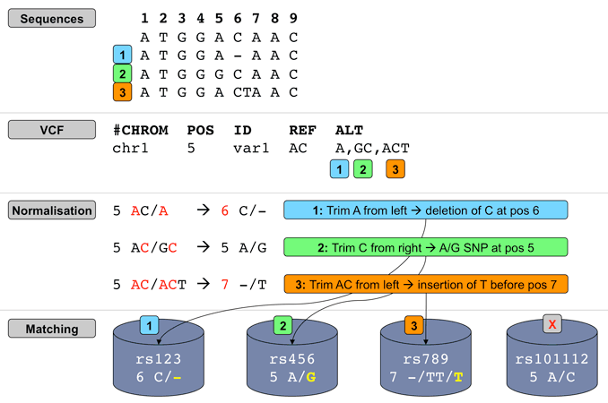
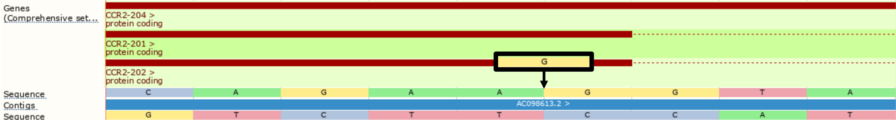
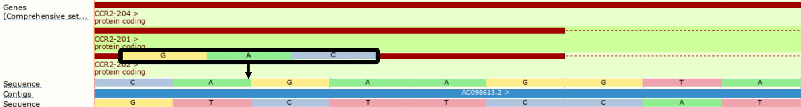

# VEP other information

**On this page**

- [Getting Ensembl VEP to run faster](/help/articles/vep-other-information#faster)
- [Species with multiple assemblies](/help/articles/vep-other-information#assembly)
- [Summarising annotation](/help/articles/vep-other-information#pick)
- [HGVS notations](/help/articles/vep-other-information#hgvs)
- [RefSeq transcripts](/help/articles/vep-other-information#refseq)
- [Existing or colocated variants](/help/articles/vep-other-information#colocated)
- [Normalising Consequences](/help/articles/vep-other-information#shifting)

## Getting Ensembl VEP to run faster

Set up correctly, Ensembl VEP is capable of annotating around 3 million variants in 30 minutes. There are a number of steps you can take to make sure your installation is running as fast as possible:

1.  Make sure you have the [latest version](/help/articles/download-and-install-vep#download) of Ensembl VEP and the underlying APIs. We regularly introduce optimisations, alongside the new features and bug fixes of a typical new release.

2.  Download a [cache file](/help/articles/vep-annotation-sources) for your species. If you are using [--database](/help/articles/vep-database-options#opt_database), you should consider using [--cache](/help/articles/vep-cache-options#opt_cache) or [--offline](/help/articles/vep-cache-options#opt_offline) instead. Any time Ensembl VEP has to access data from the database (even if you have a local copy), it will be slower than accessing data in the cache on your local file system.

    Enabling [certain flags](/help/articles/vep-annotation-sources#limitations) forces Ensembl VEP to access the database, and you will be warned at startup that it will do this with e.g.:

    <pre style="width: var(--text-column-width, 450px); max-width: 100%; box-sizing: border-box; white-space: pre-wrap; overflow-wrap: anywhere;"><code class="language-text">2011-06-16 16:24:51 - INFO: Database will be accessed when using --check_svs
    </code></pre>

    Consider carefully whether you need to use these flags in your analysis.

3.  If you use [--check_existing](/help/articles/vep-co-located-variants#opt_check_existing) or any flags that invoke it (e.g. [--af](/help/articles/vep-co-located-variants#opt_af), [--af_1kg](/help/articles/vep-co-located-variants#opt_af_1kg), [--filter_common](/help/articles/vep-filtering-and-qc-options#opt_filter_common), [--everything](/help/articles/vep-basic-options#opt_everything)), use an [indexed cache](/help/articles/vep-annotation-sources#manual_cache). Checking for known variants using an indexed cache is faster than using the default format.

4.  Download a [FASTA file](/help/articles/vep-annotation-sources#fasta) (and use the flag [--fasta](/help/articles/vep-cache-options#opt_fasta)) if you use [--hgvs](/help/articles/vep-identifiers#opt_hgvs) or [--check_ref](/help/articles/vep-filtering-and-qc-options#opt_check_ref). Again, this will prevent Ensembl VEP accessing the database unnecessarily (in this case to retrieve genomic sequence).

    

5.  Using forking enables Ensembl VEP to run multiple parallel "threads", with each thread processing a subset of your input. Most modern computers have more than one processor core, so running Ensembl VEP with forking enabled can give huge speed increases (3-4x faster in most cases). Even computers with a single core will see speed benefits due to overheads associated with using object-oriented code in Perl.

    To use forking, you must choose a number of forks to use with the [--fork](/help/articles/vep-basic-options#opt_fork) flag. We recommend using 4 forks:

    <pre style="width: var(--text-column-width, 450px); max-width: 100%; box-sizing: border-box; white-space: pre-wrap; overflow-wrap: anywhere;"><code class="language-text">./vep -i my_input.vcf --fork 4 --offline
    </code></pre>

    but depending on various factors specific to your setup you may see faster performance with fewer or more forks.

    When writing [plugins](/help/articles/vep-plugins) be aware that while the Ensembl VEP code attempts to preserve the state of any plugin-specific cached data between separate forks, there may be situations where data is lost. If you find this is the case, you should disable forking in the new() method of your plugin by deleting the "fork" key from the $config hash.

6.  Make sure your cache and FASTA files are stored on the fastest file system or disk you have available. If you have a lot of memory in your machine, you can even pre-copy the files to memory using [tmpfs](https://www.howtoforge.com/storing-files-directories-in-memory-with-tmpfs).

7.  Consider if you need to generate HGVS notations ([--hgvs](/help/articles/vep-identifiers#opt_hgvs)); this is a complex annotation step that can add ~50-80% to your runtime. Note also that --hgvs is switched on by [--everything](/help/articles/vep-basic-options#opt_everything).

8.  Install the [Set::IntervalTree](http://search.cpan.org/~benbooth/Set-IntervalTree/lib/Set/IntervalTree.pm) Perl package. This package speeds up annotation time by changing how overlaps between variants and transcript components are calculated.

9.  Install the [Ensembl::XS](https://github.com/Ensembl/ensembl-xs) package. This contains compiled versions of certain key subroutines used in Ensembl VEP that will run faster than the default native Perl equivalents. Using this should improve runtime by 5-10%.

10. Add the [--no_stats](/help/articles/vep-basic-options#opt_no_stats) flag. Calculating summary statistics increases runtime, so can be switched off if not required

11. Ensembl VEP is optimised to run on input files that are sorted by variant location. Unsorted files will still work, albeit much more slowly.

12. For very large files (for example those from whole-genome sequencing), Ensembl VEP processing can be easily parallelised by dividing your file into chunks (e.g. by chromosome). Ensembl VEP will also work with tabix-indexed, bgzipped VCF files, and so the tabix utility could be used to divide the input file:

    <pre style="width: var(--text-column-width, 450px); max-width: 100%; box-sizing: border-box; white-space: pre-wrap; overflow-wrap: anywhere;"><code class="language-text">tabix -h variants.vcf.gz 12:1000000-20000000 | ./vep --cache --vcf
    </code></pre>

## Species with multiple assemblies

Ensembl currently supports the two latest human assembly versions. We provide a cache using the latest software version (116) for both GRCh37 and GRCh38.

The [Ensembl VEP installer](/help/articles/download-and-install-vep#installer) will install and set up the correct cache and FASTA file for your assembly of interest. If using the --AUTO functionality to install without prompts, remember to add the assembly version required using e.g. "--ASSEMBLY GRCh37". It is also possible to have concurrent installations of caches from both assemblies; just use the [--assembly](/help/articles/vep-basic-options#opt_assembly) to select the correct one when you run Ensembl VEP.

Once you have installed the relevant cache and FASTA file, you are then able to use Ensembl VEP as normal. If you are using GRCh37 and require database access in addition to the cache (for example, to look up variant identifiers using [--format id](/help/articles/vep-basic-options#opt_format), see [cache limitations](/help/articles/vep-annotation-sources#limitations)), you will be warned you that you must change the database port in order to connect to the correct database:

<pre style="width: var(--text-column-width, 450px); max-width: 100%; box-sizing: border-box; white-space: pre-wrap; overflow-wrap: anywhere;"><code class="language-text">ERROR: Cache assembly version (GRCh37) and database or selected assembly version (GRCh38) do not match

If using human GRCh37 add &quot;--port 3337&quot; to use the GRCh37 database, or --offline to avoid database connection entirely
</code></pre>

If you have data you wish to map to a new assembly, you can use the Ensembl assembly converter tool - if you've downloaded Ensembl VEP, then you have it already! The tool is found in the ensembl-tools/scripts/assembly_converter folder. There is also an [online version of the tool](https://jun2026.archive.ensembl.org/info/docs/tools/index.html) available. UCSC ([liftOver](https://genome.ucsc.edu/util.html)) provides a tool for converting data between assemblies.

## Summarising annotation

By default Ensembl VEP is configured to provide annotation on every genomic feature that each input variant overlaps. This means that if a variant overlaps a gene with multiple alternate splicing variants (transcripts), then a block of annotation for each of these transcripts is reported in the output. In the [default output format](/help/articles/vep-data-formats#output) each of these blocks is written on a single line of output; in [VCF output format](/help/articles/vep-data-formats#vcfout) the blocks are separated by commas in the INFO field.

A number of options are provided to reduce the amount of output produced if this depth of annotation is not required.

### Note

Wherever possible we would discourage you from summarising data in this way. Summarising inevitably involves data loss, and invariably at some point this will lead to the loss of biologically relevant information. For example, if your variant overlaps both a regulatory feature and a transcript and you use one of the flags below, the overlap with the regulatory feature will be lost in your output, when in some cases this may be a clue to the "real" functional effect of your variant. For these reasons we recommend using one of the flagging options ([--flag_pick](/help/articles/vep-filtering-and-qc-options#opt_flag_pick), [--flag_pick_allele](/help/articles/vep-filtering-and-qc-options#opt_flag_pick_allele) or [--flag_pick_allele_gene](/help/articles/vep-filtering-and-qc-options#opt_flag_pick_allele_gene)) and to [post-filter results](/help/articles/filtering-vep-results).

### Example

Input data (VCF - input.vcf)

<pre style="width: var(--text-column-width, 450px); max-width: 100%; box-sizing: border-box; white-space: pre-wrap; overflow-wrap: anywhere;"><code class="language-text">##fileformat=VCFv4.2
#CHROM  POS  ID  REF  ALT
1  230710048  rs699  A  G
1  230710514  var_2  A  G,T
</code></pre>

Example command and output (no "pick" option):

<pre style="width: var(--text-column-width, 450px); max-width: 100%; box-sizing: border-box; white-space: pre-wrap; overflow-wrap: anywhere;"><code class="language-text">./vep --cache -i input.vcf -o output.txt

#Uploaded_variation  Location  Allele  Gene  Feature  Feature_type  Consequence  cDNA_position  CDS_position  Protein_position  Amino_acids  Codons  Existing_variation  Extra
rs699  1:230710048  G  ENSG00000135744  ENST00000366667  Transcript  missense_variant         1018  803  268  M/T  aTg/aCg  -  IMPACT=MODERATE;STRAND=-1
rs699  1:230710048  G  ENSG00000244137  ENST00000412344  Transcript  downstream_gene_variant     -    -    -    -        -  -  IMPACT=MODIFIER;DISTANCE=650;STRAND=-1
var_2  1:230710514  G  ENSG00000135744  ENST00000366667  Transcript  synonymous_variant        552  337  113    L  Ttg/Ctg  -  IMPACT=LOW;STRAND=-1
var_2  1:230710514  T  ENSG00000135744  ENST00000366667  Transcript  missense_variant          552  337  113  L/M  Ttg/Atg  -  IMPACT=MODERATE;STRAND=-1
var_2  1:230710514  G  ENSG00000244137  ENST00000412344  Transcript  downstream_gene_variant     -    -    -    -        -  -  IMPACT=MODIFIER;DISTANCE=184;STRAND=-1
var_2  1:230710514  T  ENSG00000244137  ENST00000412344  Transcript  downstream_gene_variant     -    -    -    -        -  -  IMPACT=MODIFIER;DISTANCE=184;STRAND=-1
</code></pre>

### Options

- **--pick**

  One block of annotation per variant is reported, using an ordered set of criteria. This order may be customised using [--pick_order](/help/articles/vep-filtering-and-qc-options#opt_pick_order).

  1.  [MANE Select transcript status](https://jun2026.archive.ensembl.org/info/genome/genebuild/mane.html)
  2.  [MANE Plus Clinical transcript status](https://jun2026.archive.ensembl.org/info/genome/genebuild/mane.html)
  3.  canonical status of transcript
  4.  [APPRIS isoform annotation](https://jun2026.archive.ensembl.org/glossary/ENSGLOSSARY_0000012)
  5.  [transcript support level](https://jun2026.archive.ensembl.org/glossary/ENSGLOSSARY_0000005)
  6.  biotype of transcript ("protein_coding" preferred)
  7.  CCDS status of transcript
  8.  consequence rank according to [this table](https://jun2026.archive.ensembl.org/info/genome/variation/prediction/predicted_data.html#consequences)
  9.  translated, transcript or feature length (longer preferred)

  ### Note

  Some categories may not be available for the species or cache version that you are using. For example, MANE transcripts are only assigned for human GRCh38. In these cases the category will be skipped and the next in line used.

  example command and output, with the "**--pick**" option.

  

<pre style="width: var(--text-column-width, 450px); max-width: 100%; box-sizing: border-box; white-space: pre-wrap; overflow-wrap: anywhere;"><code class="language-text">./vep --cache -i input.vcf -o output.txt --pick

rs699   1:230710048     G       ENSG00000135744 ENST00000366667 Transcript      missense_variant        843     776     259     M/T     aTg/aCg -       IMPACT=MODERATE;STRAND=-1
var_2   1:230710514     T       ENSG00000135744 ENST00000366667 Transcript      missense_variant        377     310     104     L/M     Ttg/Atg -       IMPACT=MODERATE;STRAND=-1
</code></pre>

- **--pick_allele**

  As above, but chooses one consequence block per variant allele. This can be useful for [VCF input files](/help/articles/vep-data-formats#vcf) with more than one ALT allele.

  example of Ensembl VEP command and output, with the "**--pick_allele**" option.

  

<pre style="width: var(--text-column-width, 450px); max-width: 100%; box-sizing: border-box; white-space: pre-wrap; overflow-wrap: anywhere;"><code class="language-text">./vep --cache -i input.vcf -o output.txt --pick_allele

rs699   1:230710048     G       ENSG00000135744 ENST00000366667 Transcript      missense_variant        843     776     259     M/T     aTg/aCg -       IMPACT=MODERATE;STRAND=-1
var_2   1:230710514     T       ENSG00000135744 ENST00000366667 Transcript      missense_variant        377     310     104     L/M     Ttg/Atg -       IMPACT=MODERATE;STRAND=-1
var_2   1:230710514     G       ENSG00000135744 ENST00000366667 Transcript      synonymous_variant      377     310     104     L       Ttg/Ctg -       IMPACT=LOW;STRAND=-1
</code></pre>

- **--per_gene**

  As [--pick](/help/articles/vep-filtering-and-qc-options#opt_pick), but chooses one annotation block per gene that the input variant overlaps.

  example command and output, with the "**--per_gene**" option.

  

<pre style="width: var(--text-column-width, 450px); max-width: 100%; box-sizing: border-box; white-space: pre-wrap; overflow-wrap: anywhere;"><code class="language-text">./vep --cache -i input.vcf -o output.txt --per_gene

rs699   1:230710048     G       ENSG00000135744 ENST00000366667 Transcript      missense_variant        843     776     259     M/T     aTg/aCg -       IMPACT=MODERATE;STRAND=-1
rs699   1:230710048     G       ENSG00000244137 ENST00000412344 Transcript      downstream_gene_variant -       -       -       -       -       -       IMPACT=MODIFIER;DISTANCE=650;STRAND=-1
var_2   1:230710514     T       ENSG00000135744 ENST00000366667 Transcript      missense_variant        377     310     104     L/M     Ttg/Atg -       IMPACT=MODERATE;STRAND=-1
var_2   1:230710514     G       ENSG00000244137 ENST00000412344 Transcript      downstream_gene_variant -       -       -       -       -       -       IMPACT=MODIFIER;DISTANCE=184;STRAND=-1
</code></pre>

- **--pick_allele_gene**

  As above, but chooses one consequence block per variant allele and gene combination.

  example command and output, with the "**--pick_allele_gene**" option.

  

<pre style="width: var(--text-column-width, 450px); max-width: 100%; box-sizing: border-box; white-space: pre-wrap; overflow-wrap: anywhere;"><code class="language-text">./vep --cache -i input.vcf -o output.txt --pick_allele_gene

rs699   1:230710048     G       ENSG00000135744 ENST00000366667 Transcript      missense_variant        843     776     259     M/T     aTg/aCg -       IMPACT=MODERATE;STRAND=-1
rs699   1:230710048     G       ENSG00000244137 ENST00000412344 Transcript      downstream_gene_variant -       -       -       -       -       -       IMPACT=MODIFIER;DISTANCE=650;STRAND=-1
var_2   1:230710514     T       ENSG00000135744 ENST00000366667 Transcript      missense_variant        377     310     104     L/M     Ttg/Atg -       IMPACT=MODERATE;STRAND=-1
var_2   1:230710514     T       ENSG00000244137 ENST00000412344 Transcript      downstream_gene_variant -       -       -       -       -       -       IMPACT=MODIFIER;DISTANCE=184;STRAND=-1
var_2   1:230710514     G       ENSG00000135744 ENST00000366667 Transcript      synonymous_variant      377     310     104     L       Ttg/Ctg -       IMPACT=LOW;STRAND=-1
var_2   1:230710514     G       ENSG00000244137 ENST00000412344 Transcript      downstream_gene_variant -       -       -       -       -       -       IMPACT=MODIFIER;DISTANCE=184;STRAND=-1
</code></pre>

- **--flag_pick**

  Instead of choosing one block and removing the others, this option adds a flag "PICK=1" to picked annotation block, allowing you to easily filter on this later using the [filtering tool](/help/articles/filtering-vep-results).

- **--flag_pick_allele**

  As above, but flags one block per allele.

- **--flag_pick_allele_gene**

  As above, but flags one block per allele and gene combination.

- **--most_severe**

  This flag reports only the consequence type of the block with the highest rank, according to [this table](https://jun2026.archive.ensembl.org/info/genome/variation/prediction/predicted_data.html#consequences).

  example command and output, with the "**--most_severe**" option.

  

<pre style="width: var(--text-column-width, 450px); max-width: 100%; box-sizing: border-box; white-space: pre-wrap; overflow-wrap: anywhere;"><code class="language-text">./vep --cache -i input.vcf -o output.txt --most_severe

rs699  1:230710048  -  -  -  -  missense_variant  -  -  -  -  -  -  -
var_2  1:230710514  -  -  -  -  missense_variant  -  -  -  -  -  -  -
</code></pre>

- **--summary**

  This flag reports only a comma-separated list of the consequence types predicted for this variant.

  example command and output, with the "**--summary**" option.

  

<pre style="width: var(--text-column-width, 450px); max-width: 100%; box-sizing: border-box; white-space: pre-wrap; overflow-wrap: anywhere;"><code class="language-text">./vep --cache -i input.vcf -o output.txt --summary

rs699  1:230710048  -  -  -  -  missense_variant,downstream_gene_variant                     -  -  -  -  -  -  -
var_2  1:230710514  -  -  -  -  missense_variant,synonymous_variant,downstream_gene_variant  -  -  -  -  -  -  -
</code></pre>

### Caution

Feature-specific annotation is absent from the output using the flags **--most_severe** or **--summary**, so use them with caution!

## HGVS notations

### Output

[HGVS](https://varnomen.hgvs.org) notations can be produced by Ensembl VEP using the [--hgvs](/help/articles/vep-identifiers#opt_hgvs) flag. Coding (c.) and protein (p.) notations given against Ensembl identifiers use [versioned](https://jun2026.archive.ensembl.org/info/genome/stable_ids/index.html) identifiers that guarantee the identifier refers always to the same sequence.

Genomic HGVS notations may be reported using [--hgvsg](/help/articles/vep-identifiers#opt_hgvsg). Note that the named reference for HGVSg notations will be the chromosome name from the input (as opposed to the officially recommended chromosome accession).

HGVS notations for insertions or deletions are by default reported in the most 3-prime representation in accordance with HGVS specifications. This may lead to discrepancies between the coordinates reported in the HGVS nomenclature and the coordinate columns reported by Ensembl VEP.

Reference sequence used as part of Ensembl VEP's HGVSc calculations is taken from a given FASTA file, rather than the variant reference. HGVSp is calculated using the given variant reference.

### Input

Ensembl VEP supports using HGVS notations as input. This feature is currently under development and not all HGVS notation types are supported. Notations relative to genomic (g.) or coding (c.) sequences are fully supported; protein (p.) notations are supported in limited fashion due to the complexity involved in determining the multiple possible underlying genomic sequence changes that could produce a single protein change. A warning will be given if a particular notation cannot be parsed.

By default Ensembl VEP uses Ensembl transcripts as the reference for determining consequences, and hence also for HGVS notations. However, it is possible to parse HGVS notations that use RefSeq transcripts as the reference sequence by using the [--refseq](/help/articles/vep-cache-options#opt_refseq) flag. Such notations must include the version number of the transcript e.g.

<pre style="width: var(--text-column-width, 450px); max-width: 100%; box-sizing: border-box; white-space: pre-wrap; overflow-wrap: anywhere;"><code class="language-text">NM_080794.3:c.1001C&gt;T
</code></pre>

where ".3" denotes that this is version 3 of the transcript NM_080794. [See below](/help/articles/vep-other-information#refseq) for more details on how Ensembl VEP can use RefSeq transcripts.

## RefSeq transcripts

If you prefer to exclude predicted RefSeq transcripts (those with identifiers beginning with "XM\_" or "XR\_") use [--exclude_predicted](/help/articles/vep-filtering-and-qc-options#opt_exclude_predicted). We do not support predicted RefSeq transcripts for GRCh37

### Identifiers and other data

The RefSeq cache lacks many classes of data present in the Ensembl transcript cache.

- Included in the RefSeq cache
  - Gene symbol
  - SIFT and PolyPhen-2 predictions
- **Not** included in the RefSeq cache
  - APPRIS annotation
  - TSL annotation
  - UniProt identifiers
  - CCDS identifiers
  - Protein domains
  - Gene-phenotype association data

### Differences to the reference genome

RefSeq transcript sequences may differ from the genome sequence to which they are aligned. Ensembl's API (and hence Ensembl VEP) constructs transcript models using the genomic reference sequence. These differences are accounted for using [BAM-edited transcript models](/help/articles/vep-other-information#refseq_bam). in human cache files from release 90 onwards. Prior to release 90 and in non-human species differences between the RefSeq sequence and the genomic sequence are not accounted for, so some annotations produced on these transcripts may be inaccurate. Most differences occur in non-coding regions, typically in UTRs at either end of transcripts or in the addition of a poly-A tail, causing minimal impact on annotation.

For human Ensembl VEP cache files, each RefSeq transcript is annotated with the [REFSEQ_MATCH](/help/articles/vep-data-formats#refseq_match) flag indicating whether and how the RefSeq model differs from the underlying genome.

### Correcting transcript models with BAM files

NCBI have released BAM files that contain alignments of RefSeq transcripts to the genome. From release 90 onwards, these alignments have been incorporated and used to correct the transcript models in the human RefSeq and merged cache files.

Ensembl VEP's cache building process uses the sequence and alignment in the BAM to correct the RefSeq model. If the corrected model does not match the original RefSeq sequence in the BAM, the corrected model is discarded. The success or failure of the BAM edit is recorded in the BAM_EDIT field of the Ensembl VEP output. Failed edits are extremely rare (\< 0.01% of transcripts), but any annotations produced on transcripts with a failed edit status should be interpreted with extreme caution.

Using BAM-edited transcripts causes a change to how alleles are interpreted from input variants. Input variants are typically encoded in VCFs that are called using the reference genome. This means that the alternate (ALT) allele as given in the VCF may correspond to the reference allele as found in the corrected RefSeq transcript model. Ensembl VEP will account for this, using the corrected reference allele (by enabling [--use_transcript_ref](/help/articles/vep-other-annotation-sources#opt_use_transcript_ref)) when calculating consequences, and the GIVEN_REF and USED_REF fields in the output indicate any change made. If the reference allele derived from the transcript matches any given alternate (ALT) allele, then no consequence data will be produced for this allele as it will be considered non-variant. Note that this process may also clash with any interpretation from using [--check_ref](/help/articles/vep-filtering-and-qc-options#opt_check_ref), so it is recommended to avoid using this flag.

To override the behaviour of [--use_transcript_ref](/help/articles/vep-other-annotation-sources#opt_use_transcript_ref) and force Ensembl VEP to use your input reference allele instead of the one derived from the transcript, you may use [--use_given_ref](/help/articles/vep-other-annotation-sources#opt_use_given_ref).

You can also side-load BAM files at runtime to correct transcript models on-the-fly; this allows corrections to be applied for other species, where alignments are available, or when using RefSeq GFF files, rather than the cache.

<pre style="width: var(--text-column-width, 450px); max-width: 100%; box-sizing: border-box; white-space: pre-wrap; overflow-wrap: anywhere;"><code class="language-text">./vep --cache --refseq -i variants.vcf --species mus_musculus --bam GCF_000001635.26_GRCm38.p6_knownrefseq_alns.bam
</code></pre>

BAM files are available from NCBI:

- [Human GRCh38.p13](https://ftp.ncbi.nlm.nih.gov/genomes/refseq/vertebrate_mammalian/Homo_sapiens/annotation_releases/109.20200815/GCF_000001405.39_GRCh38.p13/RefSeq_transcripts_alignments/)
- [Human GRCh37.p13](https://ftp.ncbi.nlm.nih.gov/genomes/refseq/vertebrate_mammalian/Homo_sapiens/annotation_releases/105.20190906/GCF_000001405.25_GRCh37.p13/RefSeq_transcripts_alignments/)

### Note for the GRCh37 bam file

The BAM index files (.bai) in this directory are required and will need to be renamed as the perl library used to parse the files expects the index to be named \[indexed_bam_file\].bai:

<pre style="width: var(--text-column-width, 450px); max-width: 100%; box-sizing: border-box; white-space: pre-wrap; overflow-wrap: anywhere;"><code class="language-text">mv interim_GRCh37.p13_knownrefseq_alignments_2017-01-13.bai interim_GRCh37.p13_knownrefseq_alignments_2017-01-13.bam.bai
</code></pre>

## Existing or colocated variants

Use the [--check_existing](/help/articles/vep-co-located-variants#opt_check_existing) flag to identify known variants colocated with input variant. The Ensembl VEP known variant cache is derived from Ensembl variation database and contains variants from dbSNP and [other sources](https://jun2026.archive.ensembl.org/info/genome/variation/species/sources_documentation.html).

By default a normalisation-based allele matching algorithm is used to identify known variants that match input variants. Since both input and known variants may have multiple alternate (ALT) or variant alleles, each pair of reference (REF) and ALT alleles are normalised and compared independently to arrive at potential matches. VCF permits multiple allele types to be encoded on the same line, while dbSNP assigns separate rsID identifiers to different allele types at the same locus. This means different alleles from the same input variant may be assigned different known variant identifiers.

 **Illustration of Ensembl VEP's allele matching algorithm resolving one VCF line with multiple ALTs to three different variant types and coordinates**

Note that allele matching occurs independently of any allele transformations carried out by [--minimal](/help/articles/vep-output-format-options#opt_minimal); Ensembl VEP will match to the same identifiers and frequency data regardless of whether the flag is used.

For some data sources (COSMIC, HGMD), Ensembl is not licensed to redistribute allele-specific data, so Ensembl VEP will report the existence of co-located variants with unknown alleles **without** carrying out allele matching. To disable this behaviour and exclude these variants, use the [--exclude_null_alleles](/help/articles/vep-co-located-variants#opt_exclude_null_alleles) flag.

To disable allele matching completely and compare variant locations only, use [--no_check_alleles](/help/articles/vep-co-located-variants#opt_no_check_alleles).

### Frequency data

In addition to identifying known variants, Ensembl VEP also reports allele frequencies for input alleles from major genotyping projects ([the 1000 Genomes Project](/help/articles/vep-co-located-variants#opt_af_1kg), [gnomAD exomes](/help/articles/vep-co-located-variants#opt_af_gnomade) and [gnomAD genomes](/help/articles/vep-co-located-variants#opt_af_gnomadg)). The cache currently contains only frequency data for alleles that have been submitted to dbSNP or are imported via [another source](https://jun2026.archive.ensembl.org/info/genome/variation/species/sources_documentation.html) into the Ensembl variation database. This means that until gnomAD's full data set is submitted to dbSNP and incorporated into Ensembl, the frequency for some alleles may be missing from the cache.

To access the full gnomAD data set, it is possible to use the custom annotation feature to retrieve the frequency data directly from the gnomAD VCF files; see [instructions here](/help/articles/vep-examples-and-use-cases#gnomad).

## Normalising Consequences

Insertions and deletions in repetitive sequences can be often described at different equivalent locations and may therefore be assigned different consequence predictions. Ensembl VEP can optionally convert variant alleles to their most 3' representation before consequence calculation.

In the example below, we insert a G at the start of the repeated region. Without the --shift_3prime flag, Ensembl VEP will calculate consequences at the input position and report the variant as a frameshift, and recognising that the variant lies within 2 bases of a splice site, as splice_region_variant.

<pre style="width: var(--text-column-width, 450px); max-width: 100%; box-sizing: border-box; white-space: pre-wrap; overflow-wrap: anywhere;"><code class="language-text">./vep --cache -id '3 46358467 . A AG'
</code></pre>

<pre style="width: var(--text-column-width, 450px); max-width: 100%; box-sizing: border-box; white-space: pre-wrap; overflow-wrap: anywhere;"><code class="language-text">#Uploaded_variation     Location        Allele  Gene    Feature Feature_type    Consequence     cDNA_position   CDS_position    Protein_position        Amino_acids     Codons  Existing_variation      Extra
3_46358468_-/G  3:46358467-46358468     G       ENSG00000121807 ENST00000292301 Transcript      frameshift_variant,splice_region_variant        1425-1426       940-941 314     S/RX    agc/aGgc        -
       IMPACT=HIGH;STRAND=1
...
</code></pre>

However, with --shift_3prime switched on, Ensembl VEP will right align all insertions and deletions within repeated regions, shifting the inserted G two positions to the right before consequence calculation, providing the splice_donor_variant consequence instead.

<pre style="width: var(--text-column-width, 450px); max-width: 100%; box-sizing: border-box; white-space: pre-wrap; overflow-wrap: anywhere;"><code class="language-text">./vep --cache -id '3 46358467 . A AG' --shift_3prime 1
</code></pre>

<pre style="width: var(--text-column-width, 450px); max-width: 100%; box-sizing: border-box; white-space: pre-wrap; overflow-wrap: anywhere;"><code class="language-text">#Uploaded_variation     Location        Allele  Gene    Feature Feature_type    Consequence     cDNA_position   CDS_position    Protein_position        Amino_acids     Codons  Existing_variation      Extra
3_46358468_-/G  3:46358467-46358468     G       ENSG00000121807 ENST00000292301 Transcript      splice_donor_variant    -       -       -       -       -       -       IMPACT=HIGH;STRAND=1
...
</code></pre>

Using --shift_genomic will also update the location field. However, --shift_genomic will also shift intergenic variants, which can lead to a reduction in performance.

<pre style="width: var(--text-column-width, 450px); max-width: 100%; box-sizing: border-box; white-space: pre-wrap; overflow-wrap: anywhere;"><code class="language-text">./vep --cache -id '3 46358467 . A AG' --shift_genomic 1
</code></pre>

<pre style="width: var(--text-column-width, 450px); max-width: 100%; box-sizing: border-box; white-space: pre-wrap; overflow-wrap: anywhere;"><code class="language-text">#Uploaded_variation     Location        Allele  Gene    Feature Feature_type    Consequence     cDNA_position   CDS_position    Protein_position        Amino_acids     Codons  Existing_variation      Extra
3_46358468_-/G  3:46358469-46358470     G       ENSG00000121807 ENST00000292301 Transcript      splice_donor_variant    -       -       -       -       -       -       IMPACT=HIGH;STRAND=1
...
</code></pre>

When shifting, insertions or deletions of length 2 or more can lead to alterations in the reported alternate allele. For example, an insertion of GAC that can be shifted 2 bases in the 3' direction will alter the alternate allele to CGA.

<pre style="width: var(--text-column-width, 450px); max-width: 100%; box-sizing: border-box; white-space: pre-wrap; overflow-wrap: anywhere;"><code class="language-text">./vep --cache -id '3 46358464 . A AGAC' --shift_3prime 1
</code></pre>

<pre style="width: var(--text-column-width, 450px); max-width: 100%; box-sizing: border-box; white-space: pre-wrap; overflow-wrap: anywhere;"><code class="language-text">#Uploaded_variation     Location        Allele  Gene    Feature Feature_type    Consequence     cDNA_position   CDS_position    Protein_position        Amino_acids     Codons  Existing_variation      Extra
3_46358465_-/GAC        3:46358464-46358465     CGA     ENSG00000121807 ENST00000292301 Transcript      inframe_insertion,splice_region_variant 1424-1425       939-940 313-314 -/R     -/CGA   -       IMPACT=MODERATE;STRAND=1
...
</code></pre>

<pre style="width: var(--text-column-width, 450px); max-width: 100%; box-sizing: border-box; white-space: pre-wrap; overflow-wrap: anywhere;"><code class="language-text">./vep --cache -id '3 46358464 . A AGAC' --shift_3prime 0
</code></pre>

<pre style="width: var(--text-column-width, 450px); max-width: 100%; box-sizing: border-box; white-space: pre-wrap; overflow-wrap: anywhere;"><code class="language-text">#Uploaded_variation     Location        Allele  Gene    Feature Feature_type    Consequence     cDNA_position   CDS_position    Protein_position        Amino_acids     Codons  Existing_variation      Extra
3_46358465_-/GAC        3:46358464-46358465     GAC     ENSG00000121807 ENST00000292301 Transcript      inframe_insertion       1422-1423       937-938 313     R/RR    aga/aGACga      -       IMPACT=MODERATE;STRAND=1
</code></pre>
